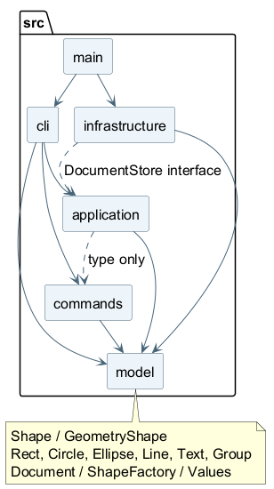

# Lab1 Phase 1：SVG 编辑器（CLI）

## 架构方案

### 模块划分

| 目录 | 职责 | 主要类 |
|---|---|---|
| src/model | 图形行为、文档树、几何验证和工厂，不执行外部 IO | Shape、GeometryShape、六种图形、Document、ShapeFactory、Values |
| src/commands | 将一条编辑封装成对象，管理该编辑的前后快照 | EditCommand 和 Create/Delete/Move/Scale/Set/Group/Ungroup/AddTo/OrderCommand |
| src/application | 当前文档、文件路径、历史屏障；定义存储接口 | Session、History、DocumentStore（接口） |
| src/cli | 分词、命令参数检查、分发、树形展示、逐行交互 | Tokenizer、CommandRouter、TreeFormatter、Cli |
| src/infrastructure | 严格解析与序列化 SVG，隔离磁盘读写 | SvgCodec、FileDocumentStore |
| src/main.ts | 组装对象，启动程序 | 仅入口，无类 |
| test | 功能、集成与架构测试 | 不属于生产模块 |

组件图已用 PlantUML 在本地渲染，可直接查看：



[PlantUML 源码](architecture.puml) · [矢量图](architecture.svg)

图中实线表示生产代码的运行时依赖，虚线表示仅用于 TypeScript 类型的依赖。源码和图片一并随仓库提交。

CLI 的 CommandRouter 同时承担参数适配和用例协调。对本阶段命令数量，这是可检查的集中入口；未来新增鼠标或 agent 通道时，应抽出可复用的用例服务，避免让第二个界面依赖 CLI。

### 设计模式的选择与落地

**Command（必需）**：每条编辑操作有具体命令对象，统一继承 EditCommand。Session.execute 调用 execute，成功后才加入 History。GroupCommand 一次修改多个节点，但只有一个历史单元。OrderCommand 用一个明确的布尔参数表达 front/back 两个方向。

**Memento（支持撤销的实现选择）**：EditCommand 保存整个 Document 的深拷贝 before/after；undo/redo 返回新的深拷贝。克隆通过各图形自己的 clone 多态实现。深拷贝保留父子关系、节点顺序、样式及文本，不共享可修改的子节点。快照方式比手工为每种编辑编写逆操作更容易验证，代价是每次编辑和历史占用与文档大小相关；本阶段规模下接受这一代价。没有为无限大文档做性能承诺，后续可改为局部 memento 或操作增量并设置历史容量。

**Composite**：Shape 定义 move/scale/set/clone 等统一行为。GeometryShape 封装几何属性及其合法性；具体叶子类声明自己的几何字段；Group 保存私有有序子节点，并把 move/scale 递归传递给子节点。组的 fill/stroke/stroke-width 写在 g 上，由 SVG 的继承语义生效；不会逐个覆盖子节点显式样式。

**简单工厂**：ShapeFactory 集中管理类型到类的创建映射。create 和 SVG 读入复用同一份定义；几何移动、缩放、设置和克隆没有按标签进行 switch。

依赖倒置体现在 DocumentStore：CLI 依赖存储接口，入口注入 FileDocumentStore，文件实现不进入图形模型。没有为了本阶段假想插件实现大型注册框架。

**仅有的按名字分派点及待重构项**：CommandRouter 的命令名映射、ShapeFactory 的类型名映射。后续分别改为命令注册和 ShapeProvider 注册。这两处集中映射仍需编辑源代码才能扩展，已明确记录，不把它们宣称为完成的插件系统。

### 依赖方向规则

| 模块 | 允许依赖 |
|---|---|
| model | model |
| commands | commands、model |
| application | application、model，以及 commands 的类型 |
| cli | cli、application、commands、model、Node 终端接口 |
| infrastructure | infrastructure、model、application 的存储接口、Node 文件接口和 XML 库 |
| main | 具体组装需要的 cli、infrastructure |

model 不得依赖其他层；commands 不得调用终端或磁盘；application 不得引用 CLI 或具体 SVG 文件实现；CLI 不得导入 infrastructure，具体依赖由 main 注入。这样更换文件格式或界面时，图形行为与历史规则保持独立。

test/architecture.test.ts 自动读取生产源文件检查模块方向、核心层外部依赖、一类一文件、文件与类同名，并禁止生产代码中的 switch 和导出的过程式函数。它是静态规则检查，不是完整的语义依赖分析，仍需结合代码阅读。

### 变化点假设

| 预计变化 | 当前决策与预留 |
|---|---|
| 新增图形及后续 box 插件 | Shape 抽象、多态克隆、工厂集中；暂不实现插件生命周期，降低本阶段复杂度 |
| 新增编辑命令 | 继承 EditCommand；分发映射集中，历史不需要识别具体命令 |
| 新增 GUI 或 agent 输入 | 图形、命令、Session 可复用；CommandRouter 中用例协调需继续拆分 |
| 新增文件格式或存储介质 | DocumentStore 隔离读写，SvgCodec 与磁盘实现分开 |
| 大文档和长撤销历史 | 快照实现清晰但成本高；暂不优化，后续引入局部快照、索引或历史容量 |
| 更广 SVG 兼容性 | 当前明确支持子集，遇到不支持的输入报错；未来扩展解析与模型，避免无声丢失语义 |

### 需求边界与解释

1. group 的选中元素来自不同父容器时，按分组前文档的深度优先顺序收集；新组放在第一项原来的父容器、原来的位置。参数顺序不改变它们原有相对顺序。若同时选中祖先和子孙则拒绝。说明书未定义跨父级的具体落点，此处为本实现的显式选择。
2. 成功的 init/read/save/canvas 修改尺寸清空两栈并设屏障。新编辑后可以撤销该编辑，但不能越过屏障访问之前的历史。canvas 查询不设屏障。失败操作不设屏障，也不清空 redo。
3. init 允许只给宽度，高度默认 600；canvas 修改要求宽高成对输入，单参数报用法错误。宽高必须有限且大于零；尺寸和半径不得为负；几何坐标允许负数、小数和科学计数法。
4. front 把节点移到同级 SVG 子节点数组末尾（最后绘制、视觉最前）；back 移到数组开头。不会跨父容器改变层次。
5. move/scale 直接修改几何属性；scale 以全局坐标原点为基准，连同坐标和尺寸相乘，不以图形中心缩放。stroke-width 和 font-size 不属于本阶段几何白名单，不随 scale 改变。
6. 根级 g 按说明书禁止 ungroup。普通 g 可以嵌套。box 未实现；带 data-kind=box 的普通 SVG g 导入时降级为 g，不提供复合图形的便利属性或内部结构保护。
7. 注释仅识别整行去除前导空格后以 # 开头的情况；不支持行尾注释，因此十六进制颜色可正确解析。双引号参数支持空字符串、空格，内部支持反斜线转义引号和反斜线；普通 Windows 路径中的其他反斜线保持原样。
8. 输入 SVG 必须有标准 namespace，支持六种图形、嵌套 g、公共样式，以及常见字体和展示属性。无 id 的元素自动补“标签名+正整数”，先扫描全部显式 id，确保不会撞上后面出现的 id。重复或非法 id 拒绝。
9. 本阶段未实现 transform、path、tspan、CSS style/class、defs/use、百分比单位或通用 XML 扩展；非零原点或与画布不一致的 viewBox 也拒绝。尺寸支持数字或 px。未知属性或元素明确报错，当前文档保持不变。背景知识里的 transform 示例不是当前可读子集，属于尚未覆盖的 SVG 兼容能力，应与教师确认是否需要扩展。输出本身是标准 SVG，可由浏览器原生显示。
10. save 无参数使用当前已关联文件，首次 init 后尚无路径则要求显式路径。成功 save 将该路径关联为当前路径；init 重置路径。文件写入先写同目录唯一临时文件，再 rename 替换；失败不更新文档路径或历史。未承诺断电时的磁盘持久化。
11. tree 使用完整 width/height 属性名，undo/redo 成功输出 undone/redone 加命令名，属于结果摘要；与样例文案略有差异。错误统一 error:，一行输出。参数错误不导致进程崩溃。

## 过程记录

以下记录来自本次实际开发，没有虚构人工评审或教师确认。

| 阶段 | 讨论、选择或发现 | 结果与证据 |
|---|---|---|
| 阅读需求 | 确认目标是 CLI、TypeScript OOP、Command 和六种内置类型；box 是后续阶段 | 先建立架构草案，再写模型，避免把未来插件当成当前必需功能 |
| 模型设计 | 使用抽象 Shape 和 GeometryShape，把属性及几何操作封装在类内 | 容器通过多态递归，无需到处判断标签；一类一文件 |
| 撤销设计 | 分组、删除子树和移动归属都需要恢复顺序和层次，单纯记录坐标不足 | 采用命令前后快照，并在草稿上执行；测试验证整体撤销和失败不污染历史 |
| SVG 读入 | 自动命名若边读边分配，会可能占用后面显式声明的 rect1 | 先预扫描显式 id，再自动分配；测试验证 rect2 等确定性结果 |
| 首轮测试 | 53 项中有一项引号用例失败。检查生成后的测试源，发现测试字符串转义丢失，实际传入的是不合法命令 | 改为 String.raw 保留测试输入中的反斜线；解析器本身无需修改；复跑 53 项全通过 |
| 验收扩展 | 增加架构检查、全部几何 setter、小数缩放、失败保存后路径保持等测试 | 共 61 项通过；原始报告见 validation/tests.tap |
| 演示验收 | 回放作业中的两节点流程图版本 A，生成真实 SVG | 8 个元素，移动撤销成功；Edge 无头浏览器实际打开并截图，图像已目视检查 |
| 独立恢复验收 | 从 Git bundle 克隆到新目录后，发现 Windows Git 的自动 CRLF 转换导致格式检查失败 | 增加 .gitattributes 固定源码 LF、启动脚本 CRLF，重新打包后再验证独立恢复 |
| 远程仓库 | 前期接口不支持建库、浏览器控制超时；用户随后手动创建私有仓库，Git 已成功获取远程初始化提交 | 合并保留初始化提交与本地开发历史，README 使用完整项目说明；已推送 main 和 final，仓库为 UchinaItachi06/svg-editor-phase1 |

本地提交按骨架、模型、命令与历史、SVG 与 CLI、测试、文档逐步进行。提交时间为实际时间；作者采用项目本地标识 SVG Lab Development，不冒充学生个人邮箱。


### 学生手动验收与实际判断

以下内容依据学生实际执行后发送的终端输出整理；不把助手的开发排错或代码讲解记为学生独立完成的活动。

学生在自己的 PowerShell 中执行 npm.cmd run check，TypeScript、格式检查均通过，61 项测试全部通过。随后在 CLI 中实际执行创建、容器移动、撤销、重做、保存、错误输入和删除恢复。

| 检查 | 实际观察 | 对应判断 |
|---|---|---|
| 创建和 in 归属 | tree 显示 node 下有 r 与 t 两个节点 | 图形归属在创建时成立 |
| move / undo / redo | 矩形 x 从 100 变为 150，undo 后回到 100；redo 后保存的文件中 r 的 x=150、t 的 x=180 | 移动容器能传递到文字与矩形，撤销和重做恢复相应状态 |
| save 后 undo | 输出 error: undo not allowed after io command | 保存后历史屏障符合要求，这条错误是预期行为 |
| 重复 id | create rect r 被拒绝 | 已有 id 不能重复创建 |
| 非法缩放 | scale node 0 被拒绝 | 缩放比例必须为正数 |
| 容器循环 | addto node node 被拒绝 | 不允许把容器移入自身 |
| 失败原子性 | 上述三次失败后，tree 的层次、坐标和颜色保持不变 | 这些失败操作未产生部分修改 |
| 删除与整体撤销 | delete node 后只剩空画布，undo 一次后整棵子树恢复 | 容器删除包含子孙，且整条删除是一个撤销单元 |

本轮手动验收未发现这些场景中的功能错误。它为上述行为提供实际证据，不等同于验证了全部 SVG 输入或所有边界。

证据：[学生 CLI 原始输出](validation/student-cli-transcript.txt)、[学生运行检查的原始输出](validation/student-automated-check.txt)、[学生保存的 SVG](validation/student-demo.svg)。浏览器预览由助手另行完成，见下图；学生没有提供亲自浏览器检查的反馈，因此不将该项写成学生的个人观察。


### 关键实现说明（助手整理，供学生复核）

本次补充将手动观察对应到实际代码。下面的代码导读是讲解材料，不作为学生已经完成阅读或掌握设计的证明：

- Command：CommandRouter 把 delete node 适配为 DeleteCommand；Session.execute 调用命令，成功后才进入 History。
- 快照撤销：EditCommand.execute 在文档副本上执行 apply，成功后保存 before/after；undo 与 redo 返回相应快照的深拷贝。
- Composite：Group.move/scale 遍历 Shape 子节点并调用同名方法；叶子自己处理几何属性，命令无需逐一判断图形标签。
- 失败原子性：apply 抛错时 Session 不替换当前文档，History.record 不执行，因此失败不污染文档或历史。

完整调用链、代码入口和设计取舍见 [代码导读](代码导读.md)。

## 一致性自查

### 模块划分

实际目录与初版一致：model / commands / application / cli / infrastructure，main 仅作组装。新增 test、examples、doc/validation 均为测试或交付辅助目录，不参与生产层依赖。接口 DocumentStore 位于 application，具体实现位于 infrastructure。

修订：从初版简要架构补全了 Memento 快照决策、跨父级分组落点、IO 历史屏障以及 SVG 子集约定；没有把尚未支持的插件或 SVG 兼容能力写成已实现。

### 依赖方向

自动检查当前通过，且抽样核对：

- commands/MoveCommand 只引用 EditCommand 和 model/Document，几何操作由图形自己完成。
- application/History 仅依赖命令与文档类型，不调用文件接口。
- cli/CommandRouter 引用 DocumentStore 接口，没有引用 FileDocumentStore。
- infrastructure/FileDocumentStore 实现 DocumentStore，具体文件读写只在基础设施层。
- model/Group 调用 Shape 的多态行为，不依赖命令或终端。

当前没有已知违反所述规则的导入。工厂和命令名映射仍为后续待重构项，不把这个局限隐藏在自查结论中。

## 质量保证手段

### 可重复检查

```text
npm ci
npm run check
```

已在 Windows、Node.js 24.19.0 验证：TypeScript strict 与 unused 检查通过，Prettier 格式检查通过，61 项自动测试全部通过、零跳过。报告保存在 validation/tests.tap。

### 人工验收证据

学生提供的两轮真实操作已纳入本文件的过程记录；原始终端输出、保存文件及助手渲染预览位于 validation/。学生手动验收与助手自动检查分开标注。

### 功能覆盖

| 验证类别 | 覆盖内容 |
|---|---|
| 基础交互 | 无文档保护、help、注释、空行、错误恢复、批处理退出码、中文 |
| 图形 | 六种类型、属性白名单、默认样式省略、小数、非法数值、移动和全部几何缩放 |
| 文档树 | 创建时 in、嵌套、跨父级分组、父子重复选择、禁止环、解组位置、根级拒绝、前后层次 |
| 历史与原子性 | 单命令撤销、子树删除恢复、分组恢复、redo 失效、显示跳过、IO 屏障、失败保留 redo、数值溢出不产生部分移动 |
| SVG 与文件 | 六类型 round-trip、文本 XML 转义、换行和回车、缺 id、重复 id、样式保留、异常 XML、未知类型/属性、读取失败、保存失败、默认路径保持 |
| 架构 | 依赖方向、核心无外部 IO、一类一文件、类文件同名、无 switch 与导出过程式函数 |
| 演示 | flowchart.commands 回放、SVG 文件生成、Edge 实际渲染 |

### 剩余限制与提交状态

完整 SVG 标准兼容、插件系统、大文档性能与交互终端的所有平台差异尚未覆盖。快照历史没有容量上限。静态架构检查不替代人工审阅；有限测试不能证明所有输入正确。

本地代码和文档已准备，最终版本由 Git final 标签定位。远程仓库为 https://github.com/UchinaItachi06/svg-editor-phase1，采用合并保留 GitHub 初始化提交及全部开发历史；远程 main 与 final 对应本次交付版本，代码、文档和验收证据一并发布。截止时间未从课程材料中获得，正式提交前仍需核对课程平台及私有仓库访问权限。若教师要求导入 transform 示例，应先扩展实现与测试，再确定最终提交版本。
